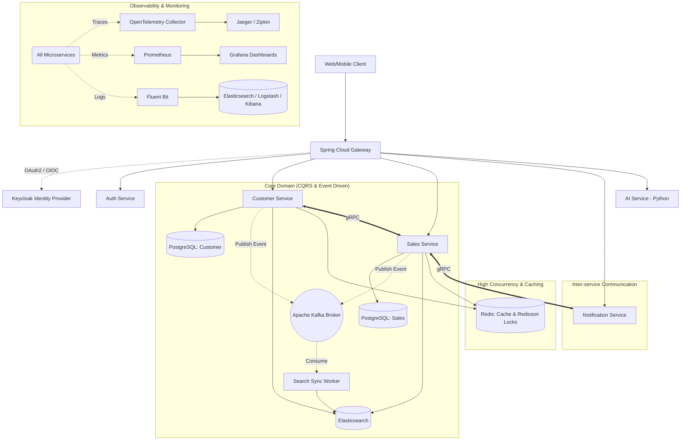

# 🚀 Enterprise CRM Microservices Platform


An ultra-scalable, robust, and highly available Enterprise Customer Relationship Management (CRM) platform built with modern **Microservices Architecture**. Designed to handle high throughput, ensuring zero data loss and maximal observability.

---

## 🌟 Core Architectural Patterns

This project acts as a technical showcase for Enterprise-grade Java engineering, implementing the following advanced patterns:

- **CQRS (Command Query Responsibility Segregation) & Event Sourcing**: Separating read and write workloads. Commands mutate state in PostgreSQL and publish events to **Apache Kafka**. Queries are served at lightning speed from **Elasticsearch** and **Redis**.
- **Event-Driven Architecture**: Decoupled services communicating asynchronously via Apache Kafka streams.
- **Distributed Locks**: Handling high-concurrency race conditions (e.g., inventory deduction, invoice generation) using **Redisson** (Redis-based distributed locks).
- **Centralized Identity Management**: Zero-trust architecture using **Keycloak** as the Identity Provider (IdP) for OAuth2.0 and OpenID Connect (OIDC).
- **Service Mesh & API Gateway**: Centralized routing, rate limiting, and security via **Spring Cloud Gateway** (replacing Kong).
- **High-Performance Inter-service Communication**: Utilizing **gRPC** and Protobuf instead of traditional REST for low-latency internal communication.
- **Database Versioning**: Schema evolution managed seamlessly with **Flyway**.
- **Resiliency & Fault Tolerance**: Implementing Circuit Breakers, Bulkheads, Retries, and Time Limiters using **Resilience4j**.

---

## 🏗 System Architecture Diagram



---

## 🛠 Tech Stack Deep Dive

### Backend & Core
- **Java 21**: Virtual Threads, Records, Pattern Matching.
- **Spring Boot 3.3.x**: Spring Web, Spring Data JPA, Spring Cloud.
- **gRPC & Protobuf**: High-throughput RPC framework.
- **MapStruct & Lombok**: Boilerplate reduction.
- **Resilience4j**: Resilience patterns.

### Data Storage & Messaging
- **PostgreSQL 17**: Primary ACID-compliant relational datastore.
- **Apache Kafka**: Distributed event streaming platform.
- **Elasticsearch 8.x**: Full-text search and distributed document store.
- **Redis (Redisson)**: In-memory data structure store, used for caching and distributed locks.
- **Flyway**: Database migration.

### Infrastructure & Observability
- **Keycloak**: Open Source Identity and Access Management.
- **Docker & Docker Compose / Kubernetes**: Containerization and Orchestration.
- **Prometheus & Grafana**: System and application metrics monitoring.
- **ELK Stack (Elasticsearch, Logstash, Kibana)**: Centralized logging.
- **Micrometer + OpenTelemetry + Jaeger**: Distributed tracing.

---

## 🚀 Getting Started

### Prerequisites
- Docker & Docker Compose (v2)
- Java 21+
- Maven 3.9+

### Spin up the infrastructure
Run the entire infrastructure (Databases, Message Broker, Observability, IAM) with a single command:
```bash
docker-compose -f docker-compose.infra.yml up -d
```

### Run the Microservices
*Note: Ensure the infrastructure is healthy before starting the services.*
```bash
docker-compose up -d --build
```

---

## 💡 Technical Highlights (For Technical Reviewers)

1. **Why Kafka + CQRS?** 
   By segregating the write (Postgres) and read (Elasticsearch) paths, the system achieves extreme read scalability. Complex search queries on Customer and Sales data don't impact the transactional database.
2. **Why Redisson over standard Redis?**
   Standard Redis is great for caching, but Redisson provides production-ready distributed Java objects and services. We heavily rely on `RLock` to prevent race conditions during high-concurrency order placements.
3. **Why gRPC internally?**
   While external clients use REST/GraphQL via the API Gateway, internal microservices use gRPC over HTTP/2. The compact binary payload of Protobuf ensures minimal network overhead and blazing-fast serialization compared to JSON.
4. **Complete Observability**
   In a microservice jungle, logs are not enough. Distributed tracing allows us to see exactly how long a request spent in the Gateway, the Auth Service, the Database, and the gRPC call to the Notification service, making bottleneck identification trivial.
